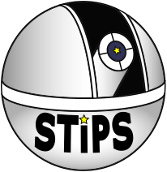

# STIPS

## STIPS

STIPS, the Small Telescope Image Processing Suite, reduces imaging from
1-meter class telescopes with the Rubin Observatory's
[LSST Science Pipelines](https://pipelines.lsst.io/). One YAML file per target
takes raw frames to calibrated lightcurves: calibration, astrometry and
photometry, image subtraction, forced photometry, and period or transit
searches.

Check out our [ReadTheDocs site](https://stips-lsst.readthedocs.io/en/latest/)
for more information on
[installation](https://stips-lsst.readthedocs.io/en/latest/installation.html),
the [quickstart](https://stips-lsst.readthedocs.io/en/latest/quickstart.html),
configuration, and the
[CLI reference](https://stips-lsst.readthedocs.io/en/latest/reference/cli.html).

Supported instruments:

* Nickel 1-m at Lick Observatory
  ([docs](https://stips-lsst.readthedocs.io/en/latest/instruments/nickel/index.html))
* CTIO 1.0-m / Y4KCam
  ([docs](https://stips-lsst.readthedocs.io/en/latest/instruments/ctio1m/index.html))
* Any similar telescope, by describing its camera in a profile directory. See
  [Adding a telescope](https://stips-lsst.readthedocs.io/en/latest/forking-stips.html).

## Contributing

See the [development guide](https://stips-lsst.readthedocs.io/en/latest/development.html)
for setup instructions, tests, and contribution practices. Questions and bug
reports are welcome on the [issue tracker](https://github.com/dangause/stips/issues).

## Citation

If you use STIPS in your work, please cite it through its Zenodo record,
[10.5281/zenodo.23243456](https://doi.org/10.5281/zenodo.23243456), and also
cite the LSST Science Pipelines it is built on. See
[Citing STIPS](https://stips-lsst.readthedocs.io/en/latest/citing.html) for
details.

Find full citation information [here](./CITATION.cff).

## License

STIPS is distributed under the [GPL-3.0-or-later](LICENSE) license.

## Acknowledgements

STIPS is built on the LSST Science Pipelines. Thanks to the Rubin Observatory
Data Management team for the infrastructure and documentation.
